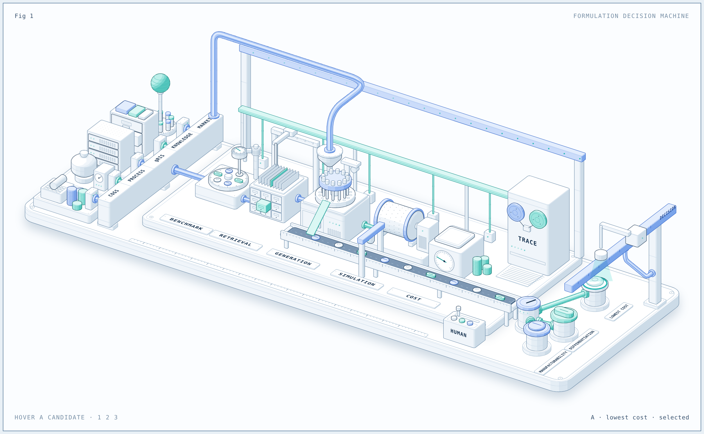

# Formulation decision machine

An interactive isometric illustration for an executive presentation, built with the
[Anatomy](https://github.com/wheresryan22/anatomy) kit (vendored in `kit/` and `scripts/`, MIT, see `LICENSE.anatomy`).



Open `formulation-machine/formulation-machine.html` in a browser. It is one self-contained page with no dependencies.

- **Five input modules** (MARKET, KNOWLEDGE, gRIS, PROCESS, COGS) each feed the intake header through their own pipe.
- **Six stations** are joined by pipes, a conveyor and an evidence bus: BENCHMARK, RETRIEVAL, GENERATION, SIMULATION, COST and TRACE.
- **Three tablet concepts** leave the sorter: lowest cost (white round), differentiation (turquoise oval) and manufacturability (blue scored round).
- **The human decision gate** selects one. Hover a pedestal, click it, or press `1` `2` `3` / the arrow keys. When idle, the machine tours the three candidates.

The dial positions in `formulation-machine/model.mjs` are illustrative, qualitative scores, not data.

## Rebuild

```sh
node formulation-machine/build.mjs           # writes formulation-machine.html
node formulation-machine/build.mjs --audit   # geometry audit (clearances, support, depth order)
node scripts/lines.mjs formulation-machine/formulation-machine.html   # line-end check (needs Chrome)
```
